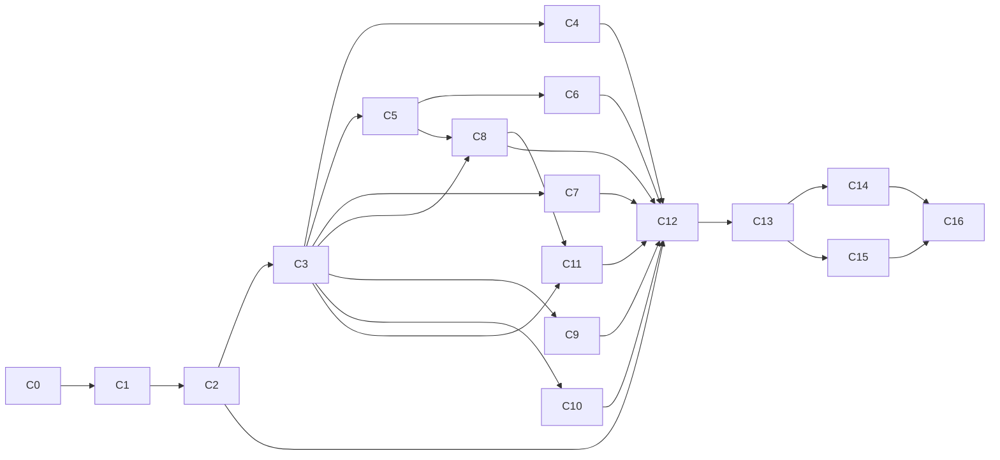

# 365CMS – Projektdokumentation | Abschnitt: Community – Roadmap & Fortschritt
> **Stand:** 2026-11-14 | **Ziel-Version:** 4.2 | **Status:** Planung | **Übersicht:** [README.md](README.md)

## English (summary)

Delivery plan for the Community module in three phases: P1 foundation and parity with `cms-forum` (shippable
release, plugin can be retired), P2 community build-out (trust levels, warnings, merge/split, mentions, drafts,
digests, polls, statistics), P3 extensions (reputation, badges, tags, group conversations, webhooks, AI signals).
Work packages (WP-C0 … WP-C16) list dependencies, deliverables, linked feature IDs and a rough effort in person-days.
The progress table at the end is the checklist; every item starts as ⬜ and is ticked only with test evidence.

## Deutsch

### 1. Phasen

| Phase | Ziel | Ergebnis |
|---|---|---|
| **P1 – Grundlage & Parität** | Alles aus deinen Prioritäten 1, 2 und den Kernpunkten aus 3 und 4, plus Parität zu `cms-forum` | Auslieferbar; `cms-forum` kann abgelöst werden |
| **P2 – Community-Ausbau** | Vertrauensstufen, Verwarnungen, Zusammenführen/Teilen, Erwähnungen, Entwürfe, Zusammenfassungs-Mails, Umfragen, Lesezeichen, Ignorieren, Online-Anzeige, Statistik, Feeds | Moderation skaliert, Mitglieder bleiben aktiv |
| **P3 – Erweiterungen** | Reputation, Abzeichen, Tags/Präfixe, Gruppen-Nachrichten (Core), Webhooks, KI-Signale, Export/Import der Struktur | Nice-to-have aus deiner Liste (OAuth als eigenes Core-Vorhaben) |

### 2. Arbeitspakete

Aufwand in Personentagen (PT), grob geschätzt einschließlich Tests und Doku; ± 30 %.

| WP | Inhalt | Features | Abhängig von | PT |
|---|---|---|---|---|
| **WP-C0** | Entscheidungen E1–E12 bestätigen (E11 gesetzt: 4.2/v27); Abhängigkeiten aus 4.1.0 nutzen (Hooks `user_deleted`/`user_role_changed`, Webhooks, Alerting, `CaptchaService` falls vorgezogen) ([README.md](README.md) §4); Bibliotheken prüfen (CommonMark, Highlighting, `gregwar/captcha`, Proof-of-Work) inkl. Lizenz, PHP 8.4/8.5, CSP | – | – | 2 |
| **WP-C1** | Modul-Gerüst: `CoreModuleService`-Eintrag, `CommunityHooks`, Einstellungen (`Support/Settings`) mit Typen/Grenzen, Sprachschlüssel, Admin-Katalog-Einträge (ausgeblendet bis Seiten existieren), Schema v27 mit allen Tabellen (`Installer`), Update-Schritt Capabilities + neue Rolle `moderator` | COM-ADM-03, COM-MOD-01 (Teil) | C0 | 5 |
| **WP-C2** | Struktur: Kategorien/Foren-Baum, Admin „Struktur“ (Drag & Drop, Tastatur), Forentypen und -status, Rechte-Matrix inkl. Vererbung, Forum-Moderatoren, `CommunityAccess` mit Tests | COM-CORE-02, COM-MOD-01, COM-MOD-02 | C1 | 8 |
| **WP-C3** | Inhalte: Themen/Beiträge erstellen, antworten, zitieren, bearbeiten mit Verlauf, weich löschen; Zähler; Seitennavigation; Startseite, Forum, Thema, Listen „Neu/Aktiv/Unbeantwortet“; Permalinks; Gelesen-Status | COM-CORE-03…06, 09, 11, 12, COM-INT-09, 10 | C2 | 12 |
| **WP-C4** | Editor & Rendering: Markdown-Renderer, Purifier-Profil `community`, Code-Highlighting, Vorschau-Endpunkt, Werkzeugleiste, lokale Entwürfe (Basis), BBCode-Renderer für Altbestand | COM-CORE-07, 08, COM-UX-05 (lokal) | C0, C3 | 7 |
| **WP-C5** | Sicherheit & Spam: `CaptchaService` (eingebaut, Proof-of-Work, Bild, Turnstile, hCaptcha, optional reCAPTCHA), Antispam-Schichten, Rate-Limits/Langsamer Modus, Wortfilter, Freigabe-Warteschlange, Sicherheits-Checkliste | COM-MOD-10, 12, 13, 14, COM-CORE-01 | C3 | 8 |
| **WP-C6** | Moderation: schließen, anpinnen, Ankündigung, verschieben, ausblenden/wiederherstellen, Beiträge verschieben, Massenaktionen, Melde-System, Sperren, Protokoll, Badges, Admin-Seiten Moderation | COM-MOD-03, 04, 06, 07, 09, 11 | C3, C5 | 9 |
| **WP-C7** | Interaktion: Abos, In-App-Benachrichtigungen (Core), Sofort-Mails, Reaktionen, Lösung markieren, Ränge, Profil-Abschnitt, „Nachricht senden“ (Core-Postfach), Mitgliederbereich `community` | COM-INT-01, 02 (sofort), 03, 05, 06, 07, 08 (1:1), COM-PLUS-01, 04 | C3 | 9 |
| **WP-C8** | Anhänge: Upload, Prüfung, Bildneukodierung, privater Speicher, Auslieferung mit Rechten, Vorschaubilder, verwaiste Uploads | COM-UX-02 | C3, C5 | 5 |
| **WP-C9** | Suche & SEO: `SearchDocumentProvider`, Suche mit Filtern und Rechtefilter, ähnliche Themen, Sitemap-Provider, kanonische URLs, Weiterleitungen, Schema.org, `noindex`-Regeln | COM-CORE-10, COM-UX-03, 06 | C3 | 6 |
| **WP-C10** | Frontend & Theme: Core-Vorlagen und Overrides, `community.css`/JS-Module, Mobile-First, Barrierefreiheit, Dark Mode; **Theme-PR `cms-phinit`** (THEME-UI §7) | COM-UX-01, 07, 09, COM-CORE-13 | C3…C9 parallel | 8 |
| **WP-C11** | DSGVO & Löschfristen: Export-/Lösch-Hooks, Anonymisierung, Löschfristen-Regeln, Legal-Textbausteine, Papierkorb-Provider | COM-UX-04, COM-ADM-06 (Papierkorb) | C3, C8 | 4 |
| **WP-C12** | Übernahme `cms-forum`: Migrator, Vorschau mit „Verhalten ändert sich“, Batch-Job, Weiterleitungen, Plugin-Abschaltung, Paritäts-Checkliste abhaken | COM-ADM-04 | C2…C11 | 7 |
| **WP-C13** | Leistung & Abnahme P1: Abfragebudget, Cache, Lasttest (10.000 Themen / 500.000 Beiträge), Lighthouse, vollständiger TEST-PLAN P1, Doku (`DOC/admin/community/`, `DOC/member/`, Hooks-Referenz, Changelog), Release | COM-UX-08 | alle P1 | 6 |
| | **Summe P1** | | | **≈ 96 PT** |
| **WP-C14** | P2 Moderation: Vertrauensstufen, Verwarnungen mit Schwellen, Zusammenführen/Teilen, IP-/Kennungshinweise | COM-MOD-05, 08, 15, 16 | P1 | 8 |
| **WP-C15** | P2 Interaktion: Erwähnungen, Zusammenfassungs-Mails, Umfragen, Lesezeichen, Ignorieren, Wer ist online, Server-Entwürfe, Emoji, automatisches Schließen, Feeds, Statistik, Export/Import der Struktur | COM-INT-02 (Digest), 04, 11, 12, 13, COM-UX-05, COM-PLUS-06, 07, 09, 12, COM-ADM-05, 06 | P1 | 12 |
| **WP-C16** | P3: Reputation, Abzeichen, Tags/Präfixe, Webhooks, KI-Signale; Core: Gruppen-Nachrichten (E8), OAuth (E9, eigenes Vorhaben) | COM-PLUS-02, 03, 08, 10, 11, COM-INT-08 (Gruppen) | P2 | 15 + Core |

### 3. Meilensteine

| Meilenstein | Inhalt | Kriterium |
|---|---|---|
| M1 – Lesbar | WP-C1…C3 | Struktur anlegen, Themen lesen/schreiben unter `/forum` auf einer Testinstallation |
| M2 – Sicher | WP-C4…C6, C8 | Sicherheits-Checkliste grün, XSS-Korpus und Rechte-Matrix bestanden |
| M3 – Parität | WP-C7, C9…C12 | Paritäts-Checkliste vollständig, Migration mit echten Daten geprobt |
| M4 – Release P1 | WP-C13 | TEST-PLAN P1 grün, Lighthouse ≥ 90, Doku und Changelog, RELEASE-Paket |

### 4. Risiken

| Risiko | Auswirkung | Gegenmaßnahme |
|---|---|---|
| Plugin-Einstellungen ohne Wirkung → nach Übernahme plötzlich wirksam | Foren verhalten sich anders (Freigabe, Gäste) | Vorschau „Verhalten ändert sich“ mit Bestätigung je Punkt (MIGRATION §4) |
| Rechte-Fehler machen interne Foren sichtbar | Datenleck | `CommunityAccess` als einzige Stelle, Rechte-Matrix-Test über alle Routen und Nebenwege (Suche, Feeds, Zitate, Benachrichtigungen, Anhänge) |
| XSS über Markdown-Sonderfälle | Kontoübernahme | Kein Roh-HTML, Purifier nach dem Renderer, XSS-Korpus im CI |
| Große Foren langsam | schlechte Nutzung, Serverlast | Denormalisierte Zähler, Indizes, Keyset-Seiten, Lasttest in WP-C13 |
| Drittanbieter-Captcha ohne Einwilligung | DSGVO-Verstoß | Standard lokal (Proof-of-Work), Drittanbieter nur nach Einwilligung, sonst Rückfall |
| Neue Vendor-Bibliotheken | Pflege, Lizenz, Supply Chain | WP-C0 prüft Lizenz/Pflege, Vendoring mit SHA-256 in `DOC/assets/`, keine CDN-Einbindung |
| Theme-Abhängigkeit (`cms-phinit`) | Mitgliederbereich zeigt alten Plugin-Weg | Theme-PR in WP-C10, Rückfall auf Plugin-Weg bleibt bis zur Abschaltung |

### 5. Fortschritt

**Legende:** ✅ erledigt · 🟡 in Arbeit · ⬜ offen · ➖ entfällt

| WP | Status | Ergebnis / Nachweis |
|---|---|---|
| Planung (dieses Dokument-Set) | ✅ | `DOC/workflow/specs/community/` (14.11.2026) |
| WP-C0 Entscheidungen & Bibliotheken | ⬜ | |
| WP-C1 Modul-Gerüst & Schema v27 | ⬜ | |
| WP-C2 Struktur & Rechte | ⬜ | |
| WP-C3 Themen, Beiträge, Gelesen-Status | ⬜ | |
| WP-C4 Editor & Rendering | ⬜ | |
| WP-C5 Sicherheit, Spam, Captcha, Warteschlange | ⬜ | |
| WP-C6 Moderation & Meldungen | ⬜ | |
| WP-C7 Interaktion & Mitgliederbereich | ⬜ | |
| WP-C8 Anhänge | ⬜ | |
| WP-C9 Suche & SEO | ⬜ | |
| WP-C10 Frontend & Theme-PR | ⬜ | |
| WP-C11 DSGVO & Löschfristen | ⬜ | |
| WP-C12 Übernahme cms-forum | ⬜ | |
| WP-C13 Leistung, Abnahme, Release P1 | ⬜ | |
| WP-C14 P2 Moderation | ⬜ | |
| WP-C15 P2 Interaktion | ⬜ | |
| WP-C16 P3 Erweiterungen | ⬜ | |
