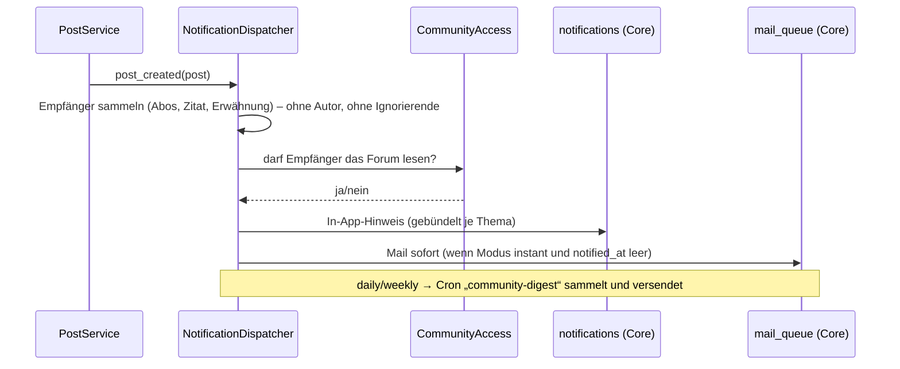
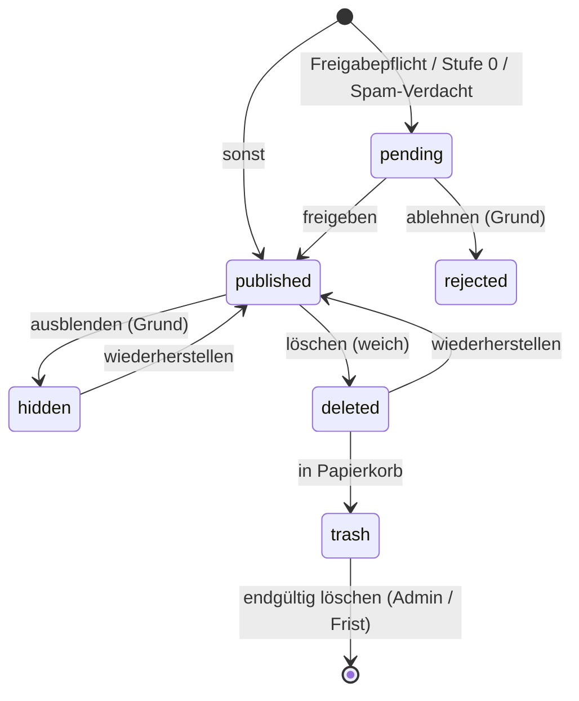

# 365CMS – Projektdokumentation | Abschnitt: Community – Abläufe
> **Stand:** 2026-11-14 | **Ziel-Version:** 4.2 | **Status:** Planung | **Übersicht:** [README.md](README.md)

## English (summary)

Step-by-step workflows of the Community module for guests, members, moderators and administrators: joining and first
post, creating a topic, replying and quoting, editing, notifications and digests, read tracking, reporting, the
approval queue, warnings and bans, moving/merging/splitting topics, marking a solution, attachments, account deletion
and data export, setting up the board, and the migration from `cms-forum`. Each workflow lists the server-side checks
in order; diagrams use Mermaid (rendered by GitHub).

## Deutsch

Jeder Ablauf nennt die **serverseitigen Prüfungen in Reihenfolge**. Die Oberfläche darf Knöpfe ausblenden,
entscheidet aber nie allein. IDs verweisen auf [FEATURES.md](FEATURES.md).

---

### W1 – Beitreten und erster Beitrag (Gast → Mitglied)

```mermaid
flowchart LR
  A[Gast liest Thema] --> B{Knopf „Antworten“}
  B -->|nicht angemeldet| C[/cms-login?redirect=…/]
  C -->|kein Konto| D[/cms-register/ + Captcha]
  D --> E[Bestätigungsmail]
  E --> F[E-Mail bestätigt → Vertrauensstufe 0→1 prüfen]
  F --> G[zurück zum Thema]
  C -->|angemeldet| G
  G --> H[Antwort schreiben]
  H --> I{Stufe 0 / Forum mit Freigabe?}
  I -->|ja| J[Status pending → Warteschlange]
  I -->|nein| K[veröffentlicht]
```

1. „Antworten“ für Gäste führt zum Core-Login mit `redirect` (nur lokale Pfade) – COM-CORE-01.
2. Registrierung über den Core, Captcha laut Einstellung (E7), Bestätigungsmail.
3. Bis zur Bestätigung: lesen ja, schreiben nein (Hinweis mit „Mail erneut senden“).
4. Erster Beitrag: Captcha (wenn Stufe 0 und eingestellt), Antispam, Rate-Limit, ggf. Freigabepflicht (COM-MOD-10, COM-MOD-15).

### W2 – Thema erstellen

1. `GET /forum/{forum}/neues-thema` → `CommunityAccess::can(create_topic)`; Formular mit Idempotenz-Token, Honeypot, Startzeit.
2. Beim Tippen des Titels: ähnliche Themen (COM-UX-06), Entwurf lokal speichern (COM-UX-05).
3. `POST`: CSRF → Rechte → Sperre → Captcha (falls nötig) → `AntispamService::evaluate()` → Rate-Limit/Langsamer Modus → Längen → Wortfilter → Link-/Bildgrenzen der Stufe → Anhänge zuordnen.
4. Speichern in einer Transaktion: Thema, erster Beitrag, Zähler Forum + Mitglied, Lesestatus des Autors, Auto-Abo.
5. Rendern (Markdown → HTML → Purifier) und `body_html` speichern.
6. Ereignis `cms_community_topic_created` → Benachrichtigungen an Forum-Abonnenten (W6), Suchindex, Cache-Version.
7. Weiterleitung auf `/forum/thema/{id}-{slug}`; Entwurf löschen.
8. Bei `pending`: Hinweis „Dein Thema wird geprüft“, Benachrichtigung an Moderation (Badge), keine Abonnenten-Hinweise bis zur Freigabe.

### W3 – Antworten und Zitieren

1. Schnellantwort unter dem Thema oder `/antworten` (Vollseite); „Zitieren“ übernimmt markierten Text oder ganzen Beitrag als `> [quote=post:ID]`.
2. Prüfungen wie W2 Schritt 3, zusätzlich: Thema nicht geschlossen (außer Moderation), Langsamer Modus des Themas.
3. Speichern + Zähler; Position des Beitrags ermitteln → Weiterleitung auf die richtige Seite mit Anker.
4. Benachrichtigungen: Themen-Abonnenten, zitierte Person (COM-INT-05), Erwähnte (COM-INT-04) – nur wenn sie das Forum lesen dürfen, nicht ignoriert, nicht der Autor selbst.
5. Neue Beiträge, die zwischen Laden und Absenden kamen, werden vor dem Speichern angezeigt („2 neue Antworten – trotzdem senden?“).

### W4 – Bearbeiten

1. Knopf sichtbar für Autor im Zeitfenster (Stufe/Forum) oder Moderation.
2. `POST`: CSRF → Rechte → Zeitfenster serverseitig → gleiche Prüfungen wie beim Erstellen.
3. Alte Fassung in `community_post_revisions`; `edit_count++`, `edited_at`, `edited_by`, `edit_reason`.
4. Anzeige „Zuletzt bearbeitet am … (von …)“; Verlauf für Moderation einsehbar (COM-CORE-05).
5. Neue Erwähnungen lösen Benachrichtigungen aus, bestehende nicht erneut.

### W5 – Gelesen/Ungelesen

1. Beim Anzeigen einer Themenseite: `last_read_post_id = max(sichtbare IDs dieser Seite)`, nur wenn größer als bisher.
2. Listen: Thema ungelesen, wenn `last_post_id > last_read_post_id` und `last_post_at > forum_read_mark`.
3. „Zum ersten ungelesenen Beitrag“: erster Beitrag mit `id > last_read_post_id` → Seite + Anker (COM-INT-09).
4. „Alle als gelesen markieren“: Eintrag in `community_forum_read_marks` (je Forum oder global), Einzelzeilen älter als die Marke werden später aufgeräumt (Löschfrist).

### W6 – Benachrichtigungen und Zusammenfassungen



1. Empfänger je Ereignis ermitteln, Rechte prüfen, Ignorieren-Liste und Einstellungen des Empfängers beachten.
2. In-App-Hinweis in `notifications` mit Gruppenschlüssel `community:topic:{id}`; Folgeereignisse erhöhen den Zähler statt neuer Zeilen.
3. Mail „sofort“ nur, wenn `notified_at` leer; beim nächsten Besuch des Themas wird `notified_at` zurückgesetzt.
4. Zusammenfassungen: Cron täglich 06:00 / wöchentlich Montag 06:00 (Site-Zeitzone), eine Mail je Mitglied, nur ungelesene Themen.
5. Jede Mail enthält einen signierten Abmeldelink (ohne Login) und den Link zu den Einstellungen.

### W7 – Melden

1. Knopf „Melden“ am Beitrag → Dialog mit Gründen und Freitext (`POST /forum/api/melden`, CSRF, Rate-Limit).
2. `CommunityAccess::can(report)`: angemeldet, `read`, nicht gesperrt, nicht der eigene Beitrag.
3. Speichern bzw. mit offener Meldung desselben Melders zusammenführen; Badge `community_reports` aktualisieren.
4. Schwelle erreicht (§7 PERMISSIONS-MODERATION) → Beitrag vorläufig ausgeblendet, Moderation benachrichtigt.
5. Moderation entscheidet (W9); Melder erhalten optional Rückmeldung.

### W8 – Freigabe-Warteschlange



1. Moderation öffnet `/admin/community-queue` (oder Frontend-Hinweis im Forum).
2. Freigeben → Status `published`, Zähler, **jetzt** Benachrichtigungen an Abonnenten (W6), Autor erhält „freigegeben“.
3. Ablehnen → `rejected` mit Grund, Autor erhält Hinweis mit Grund und Text (zum Überarbeiten).
4. Massenaktionen, jede Entscheidung im Protokoll.

### W9 – Verwarnen und Sperren

1. Aus Beitrag, Meldung oder Profil: „Verwarnen“ (Vorlage, Punkte, Ablauf) oder „Sperren“ (Umfang, Dauer, Grund).
2. Prüfungen: `community.moderate` bzw. `community.ban` für dauerhaft; Ziel hat keine gleiche/höhere Rolle.
3. Speichern, Protokoll, Hinweis + Mail an das Mitglied (Grund, Dauer, Ansprechpartner).
4. Schwellen prüfen → automatische Folge (Freigabepflicht/Schreibsperre), ebenfalls protokolliert.
5. Ablauf ohne Cron: jede Zugriffsprüfung vergleicht `ends_at` mit jetzt.

### W10 – Verschieben, Zusammenführen, Teilen

1. Verschieben: Ziel wählen, „Verweis hinterlassen (X Tage)“; Rechte in Quelle **und** Ziel; Zähler beider Foren; Abos bleiben.
2. Zusammenführen: Ziel-Thema per ID/URL; Beiträge chronologisch einsortiert; Quelle → `moved` mit `moved_to_topic_id`, Eintrag in `community_redirects` (301 dauerhaft); Abos und Lesestatus werden zusammengeführt.
3. Teilen: Beiträge in der Themenansicht auswählen → neuer Titel + Ziel-Forum; der älteste ausgewählte Beitrag wird erster Beitrag.
4. Alle drei: Cache-Version beider Themen/Foren, Suchindex, Protokoll, Hinweis an den Autor des Themas.

### W11 – Lösung markieren (Q&A)

1. Ersteller des Themas (mit `mark_solution`) oder Moderation: „Als Lösung markieren“ an einer Antwort.
2. `solution_post_id`, `solved_at`, `solved_by`; Lösung wird unter dem ersten Beitrag angezeigt; Thema „gelöst“ in Listen/Suche.
3. Autor der Lösung: Benachrichtigung, `solutions_count++`, Reputation (P3).
4. Aufheben bzw. andere Antwort wählen jederzeit; Schema.org `QAPage` mit `acceptedAnswer`.

### W12 – Anhänge hochladen

1. Ziehen/Einfügen/Knopf → `POST` mit CSRF, `CommunityAccess::can(upload)` und Stufen-Grenzen.
2. Prüfungen: Größe, Anzahl, Endung in Allowlist **und** Dateisignatur (`finfo`), Bilder mit GD/Imagick neu kodiert (entfernt Metadaten und eingebetteten Code), Größe begrenzt (Standard 2560 px), WebP; SVG nie.
3. Ablage im privaten Speicher (`community/{yyyy}/{mm}/{random}`), Datensatz mit `upload_token` ohne `post_id`.
4. Beim Absenden Zuordnung zum Beitrag; nicht zugeordnete Uploads löscht die Löschfrist nach 24 h.
5. Auslieferung nur über `/forum/anhang/{id}`: Rechte am Forum des Beitrags, `Content-Disposition` (Bilder `inline`, sonst `attachment`), `X-Content-Type-Options: nosniff`, Cache privat für interne Foren.

### W13 – Konto löschen und Daten exportieren (DSGVO)

1. Mitglied: `/member/privacy` → „Meine Daten exportieren“ / „Löschantrag“ (Core, vorhanden).
2. Export: Hook `dsgvo_export_data` liefert Themen, Beiträge (Quelle), Reaktionen, Abos, Umfrage-Stimmen, Meldungen (eigene), Verwarnungen, Sperren, Community-Profilfelder.
3. Löschung: Hook `dsgvo_delete_data` → Einstellung „Beiträge anonymisieren“ (Standard) oder „Beiträge löschen“; Anonymisieren = `user_id = NULL`, Anzeige „Gelöschtes Mitglied“, Signatur/Profil/Abos/Lesestatus/Reaktionen/Entwürfe/Ignorieren gelöscht; Zitate des Mitglieds in fremden Beiträgen bleiben Text, Namensverweise werden neutralisiert.
4. Hinweis vor der Löschung, welche Variante gilt (Datenschutztext).

### W14 – Community einrichten (Administration)

1. Modul aktivieren (`/admin/modules` oder Installer-Schritt Core-Module).
2. Assistent beim ersten Aufruf von `/admin/community`: Basis-Pfad (`forum`), Gäste dürfen lesen?, Freigabe für neue Mitglieder?, Captcha-Anbieter, Standard-Kategorie „Allgemein“ mit Forum „Vorstellung“ und „Hilfe“ (Q&A).
3. Struktur anlegen (Drag & Drop), Rechte prüfen (Matrix mit Vorschau „Was sieht Rolle X?“), Moderatoren zuweisen.
4. Rechtstexte ergänzen (Legal-Modul bietet Textbausteine), Menüeintrag „Forum“ im Theme-Menü anlegen.
5. Optional: Datenübernahme aus `cms-forum` (W15).

### W15 – Übernahme aus cms-forum (entfällt, E6)

> Entfällt: `cms-forum` war nirgends aktiv, es gibt keine Daten zu übernehmen. Text bleibt als Referenz.

1. Erkennung: aktives oder installiertes `cms-forum` und Tabellen `{prefix}cmsforum_*` → Admin-Hinweis mit Link.
2. `/admin/community-import`: Vorschau (Anzahl je Tabelle, erkannte Probleme: verwaiste Beiträge, fehlende Dateien, Spaltenvariante `text`/`option_text`).
3. Probelauf in einer Transaktion je Abschnitt mit Bericht; dann echter Lauf als Batch-Job mit Fortschritt.
4. Zweiter Lauf ändert nichts (über `legacy_id`); neue Plugin-Daten seit dem ersten Lauf werden nachgezogen.
5. Abschluss: Plugin deaktivieren (`IntegratedPluginService`), Plugin-Admin-Seiten → 301, Plugin-Tabellen bleiben bis zur bewussten Löschung erhalten.
Details: [MIGRATION-CMS-FORUM.md](MIGRATION-CMS-FORUM.md).
