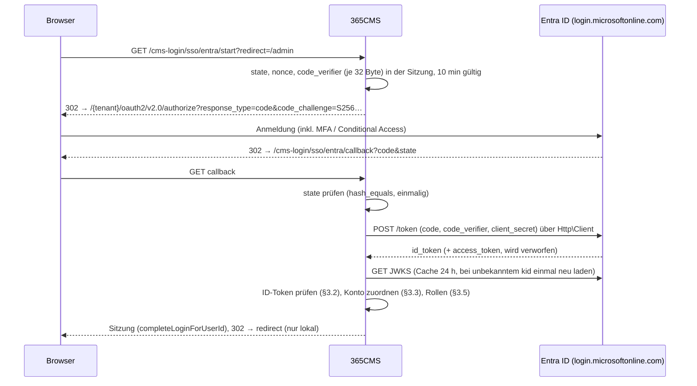

# 365CMS – Projektdokumentation | Abschnitt: Spec 4.1.0 – Bereich 1: Identität, Anmeldung & Konto-Sicherheit
> **Stand:** 2026-11-14 | **Ziel-Version:** 4.1.0 · Schema v26 | **Status:** 1a, 1b, 1c umgesetzt ([PROGRESS.md](PROGRESS.md)) | **Übersicht:** [README.md](README.md)

## English (summary)

(1a) A configurable password policy (length, character classes, optional expiry, history of the last N hashes)
replaces the hard-coded constants in `Auth`, with one service used by every place that sets a password. (1b)
Role-based MFA enforcement: users of selected roles are confined to `/mfa-setup` (and the passkey registration
endpoints) until they have TOTP or a passkey registered with user verification; Entra ID logins whose token proves
MFA (`amr` contains `mfa`) satisfy the requirement for that session. (1c) Microsoft Entra ID sign-in through OpenID
Connect (authorization code flow with PKCE, state and nonce, ID-token verification against the tenant's JWKS),
accounts bound by the immutable pair `tid`+`oid`, guarded first-time linking (lessons from phpMyFAQ advisory
GHSA-6hhv-gc4g-f4r7), optional auto-provisioning and group-to-role mapping, secret stored via `CryptoService`.

## Deutsch

---

## 1a. Konfigurierbare Passwort-Richtlinie

### 1.1 Ziel

Einstellungen unter `/admin/settings?tab=security` (Abschnitt „Passwort-Richtlinie“):

| Einstellung | Bereich | Standard (= heutiges Verhalten) |
|---|---|---|
| Mindestlänge | 8–128 | 12 |
| Großbuchstabe / Kleinbuchstabe / Ziffer / Sonderzeichen erforderlich | je Schalter | alle an |
| Höchstalter (Tage), 0 = nie | 0–730 | 0 (empfohlen, NIST SP 800-63B) |
| Historie: keine Wiederverwendung der letzten *N* Passwörter, 0 = aus | 0–24 | 5 |

Die Richtlinie gilt für **alle** Stellen, an denen ein Passwort gesetzt wird: Registrierung, Admin legt Benutzer an bzw.
ändert das Passwort, Mitglied ändert sein Passwort, Passwort zurücksetzen, Installer (nur Länge/Klassen, keine Historie).
SSO-Konten ohne lokales Passwort sind ausgenommen (01-IDENTITY §3.6).

### 1.2 Technik

- **`CMS\Services\Security\PasswordPolicyService`** (neu):
  - `definition(): array` – wirksame Richtlinie (Einstellungen → Filter `cms_password_policy` → Grenzen erzwingen).
  - `evaluate(string $password, ?int $userId = null): array` – gleiche Struktur wie heute `Auth::evaluatePasswordPolicy()` (Anforderungen mit `key`, `label`, `message`, `passed`), zusätzlich Anforderung `history` bei `$userId`.
  - `isReused(int $userId, string $password): bool` – `password_verify()` gegen aktuellen Hash und die letzten *N* aus `password_history`.
  - `recordChange(int $userId, string $newHash, string $source): void` – alten Hash in `password_history` übernehmen, `users.password_changed_at = NOW()`, überzählige Einträge löschen, Hook `cms_password_changed`.
  - `isExpired(int $userId): bool` – `password_changed_at` (Rückfall `created_at`) älter als Höchstalter.
- **`Auth::evaluatePasswordPolicy()` / `validatePasswordPolicy()`** bleiben als öffentliche API und delegieren an den Dienst (keine Änderung für Aufrufer, die nur Stärke prüfen); neue optionale Parameter `?int $userId`.
- **Aufrufer mit Benutzer-ID** (`MemberService::changePassword`, `UserService::updateUser`, `CmsAuthPageService` Zurücksetzen) übergeben die ID und rufen nach dem Speichern `recordChange()` auf.
- **Ablauf:** Nach dem Login (Passwort-Weg) mit abgelaufenem Passwort: Sitzungsflag `password_change_required`; die Weiche in `Router::dispatch()` (gemeinsam mit 1b) erlaubt dann nur die Passwort-Änderungsseite, Abmelden und statische Assets.
- **Admin-Ansicht:** Abschnitt im bestehenden Tab `admin/settings-tabs/security.php` (eigenes CSRF-Token `admin_password_policy`, Capability `security.policies` bzw. bis zur Rechtevergabe `manage_settings`), Live-Prüfung im Browser über die vorhandene Policy-Definition (kein Inline-Skript).

### 1.3 Datenmodell (v26)

```sql
ALTER TABLE {p}users ADD COLUMN password_changed_at DATETIME NULL;
CREATE TABLE {p}password_history (
  id BIGINT UNSIGNED AUTO_INCREMENT PRIMARY KEY,
  user_id INT UNSIGNED NOT NULL,
  password_hash VARCHAR(255) NOT NULL,
  created_at DATETIME NOT NULL,
  KEY idx_user_created (user_id, created_at)
);
```

Bestandskonten: `password_changed_at = NULL` → Ablauf rechnet ab `created_at`; ein Update-Schritt setzt bei aktivem Ablauf
nichts automatisch ab (kein Massen-Zwangswechsel ohne Ankündigung, Admin-Hinweis stattdessen).

### 1.4 Tests (`TESTS/password-policy/run.php`)

Grenzen und Standards; jede Zeichenklasse an/aus; Unicode-Länge; Historie (Wiederverwendung des aktuellen und eines alten
Passworts abgelehnt, älter als *N* erlaubt); Kürzen der Historie; Ablauf mit und ohne `password_changed_at`;
Filter `cms_password_policy` kann nur verschärfen; Gegenprobe.

---

## 1b. Rollenbasierter MFA-Zwang

### 2.1 Ziel

Einstellung „MFA erzwingen für Rollen“ (Mehrfachauswahl, Standard leer). Gehört ein angemeldetes Konto zu einer dieser
Rollen und hat es **keinen anerkannten zweiten Faktor**, darf es nur noch:
`/mfa-setup` (GET/POST), Passkey-Registrierung im Mitgliederbereich (`/member/security` Passkey-Endpunkte),
`/logout`, statische Assets. Alles andere → 302 auf `/mfa-setup` (API/JSON: 403 mit `{"error":"mfa_setup_required"}`).

**Anerkannte Faktoren:** aktives TOTP (`isMfaEnabled`) **oder** mindestens ein Passkey mit `user_verified = 1`
**oder** (nur für die laufende Sitzung) eine Entra-Anmeldung, deren ID-Token MFA belegt (`amr` enthält `mfa`).

### 2.2 Technik

- **`CMS\Services\Security\MfaEnforcementService`** (neu): `enforcedRoles()`, `isRequiredFor(object $user): bool`, `hasRecognisedFactor(int $userId): bool`, `allowedDuringSetup(string $path, string $method): bool`, Filter `cms_mfa_enforcement_required`.
- **Weiche in `Router::dispatch()`** direkt nach der Wartungsmodus-Prüfung und vor dem CSRF-Block: eine Methode `enforceAccountGates()` für MFA-Zwang **und** Passwort-Ablauf (1a). Kein Zugriff auf den Inhalt, bevor die Weiche entschieden hat.
- **Passkeys:** `WebAuthnAdapter::storeCredential()` speichert `user_verified` aus `$data->userVerified`; bei einer Passkey-Anmeldung mit gesetztem UV-Bit wird ein bestehender Eintrag nachträglich auf `1` gesetzt. Bestandspasskeys (`NULL`) zählen erst nach einer Anmeldung mit UV.
- **Regel „Admin kann sich nicht aussperren“:** Speichern der Einstellung prüft, ob der speichernde Admin selbst betroffen ist und keinen Faktor hat → Hinweis „Richte zuerst MFA ein“ und Speichern wird abgelehnt.
- **Abschalten von MFA** (`/mfa-disable`) wird für Konten mit Zwang abgelehnt, solange kein anderer anerkannter Faktor bleibt.
- **Audit-Log:** `mfa_enforcement_redirect` (einmal je Sitzung), Änderungen der Einstellung.

### 2.3 Tests (`TESTS/mfa-enforcement/run.php`)

Matrix Rolle × Faktor (kein, TOTP, Passkey UV=1, Passkey UV=NULL/0, Entra mit `amr=mfa`, Entra ohne) × Pfad
(Admin-Seite, Mitgliederseite, öffentliche Seite, `/mfa-setup`, Passkey-Registrierung, `/logout`, API) → erwartete
Entscheidung; Selbstaussperr-Schutz; `/mfa-disable` bei Zwang; Gegenprobe.

---

## 1c. Microsoft Entra ID – Single Sign-On (OpenID Connect)

### 3.1 Ablauf (Authorization Code Flow mit PKCE)



Endpunkte (öffentlich, CSRF-Ausnahme nur für den Callback, geschützt durch `state`):
`GET /cms-login/sso/entra/start`, `GET /cms-login/sso/entra/callback`; im Mitgliederbereich
`POST /member/security/sso/entra/link` (aktive Verknüpfung, CSRF + Re-Auth) und `…/unlink`.

### 3.2 Prüfung des ID-Tokens (alle Punkte Pflicht)

| Prüfung | Regel |
|---|---|
| Signatur | RS256 mit Schlüssel aus JWKS `https://login.microsoftonline.com/{tenant}/discovery/v2.0/keys` (`firebase/php-jwt` `JWK::parseKeySet`, `CachedKeySet`); nur `RS256` erlaubt, `alg=none`/HS* abgelehnt |
| `iss` | exakt `https://login.microsoftonline.com/{tid}/v2.0`; bei Single-Tenant `tid` = konfigurierter Tenant; Multi-Tenant nur mit Allowlist |
| `aud` | = Client-ID |
| `exp`, `nbf`, `iat` | mit Uhrzeittoleranz 120 s |
| `nonce` | = Sitzungs-Nonce (einmalig, danach gelöscht) |
| `tid`, `oid` | vorhanden, GUID-Format |
| `ver` | `2.0` |

Gespeichert werden **keine Tokens**; nur `tid`, `oid`, Zeitpunkt, `amr`-Auswertung (bool) für die Sitzung.

### 3.3 Konto-Zuordnung (Schutz gegen Kontoübernahme, GHSA-6hhv-gc4g-f4r7)

Reihenfolge:

1. **Bestehende Bindung** `user_identities (provider='entra', tenant_id=tid, subject=oid)` → dieses Konto. Ist es gesperrt/inaktiv → Ablehnung (nie reaktivieren).
2. **Keine Bindung, automatische Verknüpfung** nur wenn **alle** Bedingungen gelten (Einstellung „Bestehende Konten automatisch verknüpfen“, Standard **aus**):
   - Single-Tenant-Konfiguration (fester `tid`);
   - Claim `email` vorhanden **und** `xms_edov = true` (E-Mail-Domain vom Tenant verifiziert; optionaler Claim, im App-Manifest zu aktivieren) – `preferred_username`/`upn` werden **nie** zur Zuordnung verwendet;
   - Domain der Adresse steht in der Allowlist „Erlaubte Domains“;
   - genau ein lokales Konto mit dieser Adresse, dessen E-Mail lokal **bestätigt** ist (`EmailVerificationService`) und das aktiv ist;
   - dieses Konto hat **keine** Rolle mit Admin-Zugriff und keine Rolle aus dem MFA-Zwang (privilegierte Konten nur aktiv nach lokalem Login, Punkt 4).
3. **Keine Bindung, kein lokales Konto:** Auto-Provisioning (Einstellung, Standard aus) legt ein Konto an (Rolle aus dem Mapping, mindestens `member`; Benutzername aus Anzeigename + Zufall; zufälliges, nie mitgeteiltes Passwort; E-Mail als bestätigt nur bei `xms_edov = true`). Sonst → Hinweis „Kein Konto verknüpft“.
4. **Aktive Verknüpfung:** angemeldetes Konto startet in `/member/security` „Mit Microsoft verknüpfen“ (Re-Auth mit Passwort oder Passkey), danach derselbe Flow mit Ziel „verknüpfen“ → Bindung an **dieses** Konto.

Nie: E-Mail überschreiben, Benutzernamen übernehmen, Konten reaktivieren, Rolle eines bestehenden Kontos ohne Mapping-Regel ändern, Kollisionen still auflösen (Ablehnung + Audit-Log `sso_link_conflict`).

### 3.4 MFA und SSO

- Entra-Anmeldung mit `amr` ⊇ `mfa` (oder `amr` enthält `ngcmfa`, `rsa`, `fido`, `wia`+Gerät mit MFA laut Einstellung) gilt für die **Sitzung** als zweiter Faktor (1b).
- Entra-Anmeldung ohne MFA-Nachweis bei Rolle mit MFA-Zwang: lokale TOTP-/Passkey-Abfrage wie beim Passwort-Login; fehlt ein lokaler Faktor → Hinweis „Bitte MFA in Entra (Conditional Access) aktivieren oder lokal einrichten“; die lokale Einrichtung über `/mfa-setup` akzeptiert für SSO-Sitzungen die frische SSO-Anmeldung (≤ 10 min) statt des Passworts als Re-Auth.

### 3.5 Rollen-Mapping

- Quelle: Claim `groups` (Gruppen-Objekt-IDs; bei > 200 Gruppen „Overage“ → Graph-Abfrage `memberOf` über `GraphApiService` mit App-Berechtigung `GroupMember.Read.All`, optional) oder `roles` (App-Rollen, empfohlen).
- Tabelle Gruppe/App-Rolle → CMS-Rolle in den Einstellungen; Reihenfolge = Priorität; höchstens eine Rolle (das Core-Modell kennt eine Rolle je Konto).
- Anwendung: bei Provisioning immer; bei bestehenden Konten nur, wenn „Rollen bei jeder Anmeldung synchronisieren“ aktiv ist **und** das Konto über SSO angelegt wurde (`user_identities.provisioned = 1`). Herabstufen ist erlaubt, Hochstufen auf `admin` nur, wenn die Mapping-Regel ausdrücklich „Admin erlauben“ trägt.
- Jede Rollenänderung: Audit-Log `sso_role_changed`, Hook `user_role_changed`.

### 3.6 Konfiguration (Gruppe `auth_entra`)

| Schlüssel | Typ | Hinweis |
|---|---|---|
| `enabled` | bool | Knopf „Mit Microsoft anmelden“ auf `/cms-login` |
| `tenant_id` | GUID | Pflicht (Single-Tenant); Übernahme aus Mail-Konfiguration anbieten |
| `allowed_tenants` | Liste GUID | nur Multi-Tenant |
| `client_id` | GUID | |
| `client_secret` | **verschlüsselt** (`SettingsService::set(…, true)`) | nie im Formular zurückgeben (Platzhalter „gespeichert“), Ablaufdatum optional für Admin-Hinweis 30 Tage vorher |
| `scopes` | fest `openid profile email` | |
| `auto_link`, `allowed_domains` | bool, Liste | §3.3 |
| `auto_provision`, `default_role` | bool, Rolle | §3.3 |
| `role_mapping`, `sync_roles`, `allow_admin_mapping` | JSON, bool, bool | §3.5 |
| `mfa_from_amr` | bool (Standard an) | §3.4 |
| `local_login` | `all` / `admins_only` / `disabled_for_linked` | Lokale Anmeldung (Passwort, Passkey, LDAP) für verknüpfte Konten abschaltbar; Admin-Notfallzugang bleibt (`admins_only`) |

Redirect-URI wird angezeigt (`{SITE_URL}/cms-login/sso/entra/callback`), Client-Secret-Test („Verbindung prüfen“: Discovery + Token-Endpunkt mit falschem Code → erwarteter Fehler `invalid_grant` = Secret gültig).

### 3.7 Dateien

| Datei | Inhalt |
|---|---|
| `core/Auth/SSO/OidcProviderInterface.php` | `authorizationUrl()`, `exchangeCode()`, `verifyIdToken()` |
| `core/Auth/SSO/EntraIdProvider.php` | Entra-spezifisch (Endpunkte, `iss`-Regel, `xms_edov`, `amr`) |
| `core/Auth/SSO/OidcFlowState.php` | state/nonce/PKCE in der Sitzung, Einmalverwendung, Ablauf |
| `core/Auth/SSO/IdentityLinker.php` | Zuordnung §3.3, Provisioning, Rollen-Mapping |
| `core/Routing/SsoRouter.php` | Routen §3.1 |
| `admin/settings-tabs/sso.php`, `admin/views/settings/sso.php` | Einstellungen (Tab `?tab=sso`, Capability `security.sso`) |
| `member/security.php` (Abschnitt) | Verknüpfen/Trennen |
| `assets/js/admin-sso-settings.js` | Mapping-Tabelle, ohne Inline-Skript |

### 3.8 Datenmodell (v26)

```sql
CREATE TABLE {p}user_identities (
  id INT UNSIGNED AUTO_INCREMENT PRIMARY KEY,
  user_id INT UNSIGNED NOT NULL,
  provider VARCHAR(20) NOT NULL,          -- entra
  tenant_id CHAR(36) NOT NULL,
  subject VARCHAR(64) NOT NULL,           -- oid (unveränderlich)
  email_at_link VARCHAR(150) NULL,        -- nur Anzeige/Audit
  provisioned TINYINT(1) NOT NULL DEFAULT 0,
  linked_at DATETIME NOT NULL, last_login_at DATETIME NULL,
  UNIQUE KEY uq_subject (provider, tenant_id, subject),
  UNIQUE KEY uq_user_provider (user_id, provider),
  KEY idx_user (user_id)
);
ALTER TABLE {p}passkey_credentials ADD COLUMN user_verified TINYINT(1) NULL;
```

### 3.9 Sicherheits-Gates

- [x] `state`, `nonce`, PKCE (S256) Pflicht; Callback ohne gültigen `state` → 400 + Audit.
- [x] Token-Endpunkt und JWKS nur `login.microsoftonline.com` über `Http\Client` (SSRF-Schutz bleibt aktiv), Antwortgröße begrenzt.
- [x] Zuordnung nur über `tid`+`oid`; E-Mail-Verknüpfung nur nach §3.3.
- [x] Rücksprungziel nur lokal (gleiche Prüfung wie der Login-`redirect`).
- [x] Rate-Limit `sso_callback` je IP (`Security::checkDbRateLimit`).
- [x] Session-ID nach Login erneuert (`completeLoginForUserId`).
- [x] Client-Secret nur verschlüsselt, nie in Logs/Fehlermeldungen; Fehler von Entra gekürzt und escaped.

### 3.10 Tests (`TESTS/sso-entra/run.php`)

Mit lokal erzeugtem RSA-Schlüssel und Fake-JWKS/Token-Endpunkt (kein Netzwerk): gültiges Token; jede Pflichtprüfung aus
§3.2 einzeln verletzt (falsche Signatur, `alg=none`, HS256 mit Public Key als Secret, falscher `iss`/`aud`/`tid`,
abgelaufen, falsche/wiederverwendete `nonce`); `state` fehlt/wiederverwendet/abgelaufen; Zuordnungsfälle aus §3.3
inkl. Angriff „`preferred_username` = admin“ und „E-Mail eines Admin-Kontos ohne `xms_edov`“; gesperrtes Konto;
Provisioning an/aus; Rollen-Mapping mit Herab-/Hochstufung; `amr`-Auswertung; Gegenprobe.

### 3.11 Umsetzung (14.11.2026) – Abweichungen und Präzisierungen

| Punkt | Umsetzung |
|---|---|
| Callback und `SameSite=Strict` | Das Sitzungs-Cookie fehlt beim Rücksprung von `login.microsoftonline.com`. Der Callback liefert zuerst eine Zwischenseite (`<meta http-equiv="refresh">` auf dieselbe URL mit `hop=1`); erst dieser von der eigenen Seite ausgelöste Aufruf trägt die Sitzung. In Chromium nachgestellt. |
| Verknüpfen/Trennen | Statt eigener Routen `POST /member/security/sso/entra/link` und `…/unlink` die Aktionen `sso_link`/`sso_unlink` auf `/member/security` (CSRF `security_sso`, Passwort) – gleiche Konvention wie die Passkey-Aktionen; `/member/security` ist auch während der Konto-Weiche erreichbar. Re-Auth nur per Passwort (kein Passkey-Re-Auth im Bestand). |
| Zusätzliche Dateien | `EntraSettings` (Gruppe `auth_entra`), `EntraSsoService` (Ablauf), `IdentityStoreInterface` + `DatabaseIdentityStore` (austauschbar für Tests). |
| „Rollen mit Admin-Zugriff“ (§3.3) | `admin`, `editor`, `author` plus alle Rollen mit MFA-Zwang werden nie automatisch verknüpft. |
| `allow_admin_mapping` | eine globale Einstellung; eine Mapping-Regel auf `admin` wirkt nur, wenn sie gesetzt ist. Die Standardrolle ist nie `admin`. |
| Rollen-Sync ohne passende Regel | Zielrolle = Standardrolle (Herabstufen), nur für provisionierte Konten mit „synchronisieren“. |
| Gruppen-Overage | keine Graph-Abfrage; Audit `sso_groups_overage`, es zählen nur App-Rollen. |
| `amr` | anerkannt: `mfa`, `ngcmfa`, `fido`, `rsa` (Einstellung `mfa_from_amr`). Fehlt `amr` im v2-Token, gilt das als kein Nachweis. |
| `local_login` | Gilt für alle lokalen Wege: Passwort (`Auth::login`), Passkey und LDAP (`AuthManager`), geprüft nach dem jeweiligen Faktor über `EntraSsoService::rejectLocalLogin()`. `disabled_for_linked`: verknüpfte Nicht-Admins nur über Microsoft; `admins_only`: lokal nur Admins. Wirkt nur bei fertig eingerichteter SSO-Anmeldung. Audit `login_local_disabled`. Laufende lokal begonnene Sitzungen betroffener Konten enden mit der nächsten Anfrage (`Auth::checkSession` → `EntraSettings::sessionMayContinue()`, Modus aus der autoload-Option `local_login_enforced`), über Microsoft begonnene bleiben; Audit `session_local_login_ended`. |
| Re-Auth über frische SSO-Anmeldung | `/mfa-setup` sowie `totp_start`/`passkey_register` im Mitgliederbereich; Entfernen von Faktoren, Verknüpfen und Trennen verlangen weiter das Passwort. |
| Provisioning | verlangt den Claim `email` (sonst Ablehnung); bestätigt (`email_verified_at`) nur mit `xms_edov`. Existiert ein Konto mit der Adresse und greift die automatische Verknüpfung nicht → Ablehnung + `sso_link_conflict`, nie ein zweites Konto. |
| Capability `security.sso` | in `RolesModule` vergebbar; die Vergabe an Standardrollen folgt mit dem Update-Schritt `capabilities_v26` (Admins haben sie über die Rolle). |
