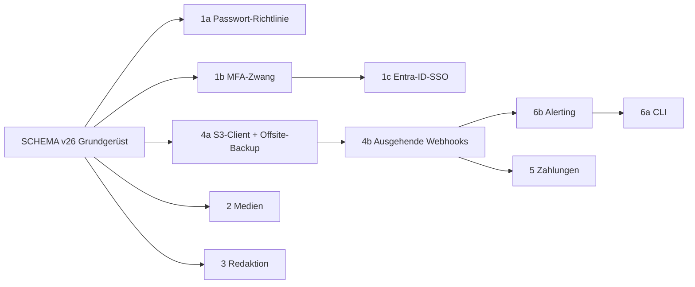

# 365CMS – Projektdokumentation | Abschnitt: Workflow – Spec: Release 4.1.0
> **Stand:** 2026-11-14 | **Ziel-Version:** 4.1.0 · Schema **v26** | **Status:** Spezifikation, Umsetzung Bereich 1 und 4 begonnen | **Update:** 2026-11-14
> **Fortschritt:** [PROGRESS.md](PROGRESS.md) · **Schema:** [SCHEMA-v26.md](SCHEMA-v26.md) · **Referenzen:** [REFERENCES.md](REFERENCES.md)

## English (summary)

Technical architecture and implementation plan for 365CMS 4.1.0 with six feature areas: (1) identity – Entra ID
single sign-on via OpenID Connect, configurable password policy with history and expiry, role-based MFA enforcement;
(2) media – AVIF derivatives, media usage index across all content types; (3) editorial – four-eyes review status
`pending`, reusable Editor.js blocks, content expiry and review dates; (4) S3-compatible offsite backups with a
native Signature-V4 client and signed outbound webhooks; (5) Stripe and Mollie/PayPal payments with signed webhooks
and sequential PDF invoices; (6) a CLI runner and real-time admin alerting. All schema changes share one bump to v26; the
Community module follows in 4.2 with schema v27. Every area lists services, files, tables, capabilities, hooks,
security gates and tests. Implementation starts with areas 1 and 4.

## Deutsch

### 1. Dokumente

| Dokument | Bereich |
|---|---|
| [01-IDENTITY.md](01-IDENTITY.md) | Entra-ID-SSO (OIDC), Passwort-Richtlinie mit Historie und Ablauf, rollenbasierter MFA-Zwang |
| [02-MEDIA.md](02-MEDIA.md) | AVIF-Derivate, Verwendungsnachweis für Medien |
| [03-CONTENT-WORKFLOWS.md](03-CONTENT-WORKFLOWS.md) | Vier-Augen-Prinzip (`pending`), wiederverwendbare Blöcke, Ablauf- und Prüfdaten |
| [04-BACKUP-WEBHOOKS.md](04-BACKUP-WEBHOOKS.md) | S3-kompatible Offsite-Backups, ausgehende Webhooks |
| [05-PAYMENTS.md](05-PAYMENTS.md) | Stripe, Mollie/PayPal, Webhooks, PDF-Rechnungen mit Nummernkreis |
| [06-CLI-ALERTING.md](06-CLI-ALERTING.md) | `CMS/cli.php`, Echtzeit-Alerting mit Cooldown |
| [SCHEMA-v26.md](SCHEMA-v26.md) | Alle Tabellen und Spalten des Schema-Stands v26 |
| [REFERENCES.md](REFERENCES.md) | Bewertung der im Auftrag verlinkten Repositories und der Sicherheitsmeldung GHSA-6hhv-gc4g-f4r7 |
| [PROGRESS.md](PROGRESS.md) | Fortschritt je Arbeitspaket mit Nachweisen |

### 2. Verbindliche Leitplanken

Aus dem Auftrag und dem Bestand von 4.0.0:

1. **Kein Build-Schritt:** Vanilla-ES-Module unter `CMS/assets/js/`, Tabler-Tokens (`--tblr-*`, `--cms-*`), keine Inline-Skripte und keine Inline-Handler (CSP mit Nonce und Trusted Types).
2. **Sicherheit:** nur gebundene SQL-Parameter; CSRF-Token je Aktion (`Security::generateToken`/`verifyToken`); Capability-Prüfung bei jeder Admin-Aktion; lokale Pfade über `Security::safeLocalPath()`; ausgehende HTTP-Anfragen nur über `CMS\Http\Client` (SSRF-Schutz, DNS-Pinning, Größenlimit); Geheimnisse nur verschlüsselt über `SettingsService::set(…, encrypted: true)` → `CryptoService` (XChaCha20-Poly1305, Kontext `settings`, Bindung an den Optionsnamen).
3. **Schema:** ein gemeinsamer Stand **v26** für alle 4.1.0-Funktionen; das Community-Modul folgt in **4.2** mit **v27** ([../community/README.md](../community/README.md)); Definitionen nur in `SchemaManager::getSchemaQueries()`, Update über `MigrationManager::run()` (idempotent, wie v25).
4. **Tests unter `TESTS/`** und Handbuch-Updates unter `DOC/`. Hinweis: `TESTS/` wurde am 14.11.2026 aus `main` entfernt (Commit `6edfacc`); der Auftrag verlangt Tests dort, deshalb entsteht das Verzeichnis für die 4.1.0-Suiten neu (`TESTS/<suite>/run.php`, eigenständig, ohne Datenbank, Exit-Code 1 bei Fehlern).
5. **Keine schweren Vendor-SDKs** für S3, Zahlungen und OIDC: schlanke eigene Clients über `Http\Client`; vorhandene Bibliotheken (`firebase/php-jwt`, `robthree/twofactorauth`, `lbuchs/WebAuthn`, Dompdf) werden genutzt.
6. **MultiSite:** keine Site-Dimension für Inhalte ([KLARSTELLUNGEN.md](../KLARSTELLUNGEN.md) §3).

### 3. Reihenfolge und Abhängigkeiten

- **Bereich 1 vor 5:** Zahlungen und Abos setzen sichere Konten voraus (MFA-Zwang für Admins mit Bestellzugriff).
- **4b (Webhooks) vor 6b (Alerting) und 5:** dieselbe Signatur- und Zustelllogik für ausgehende Webhooks.
- **Bereich 3 baut auf [ROADMAP-CONTENT-PLATFORM.md](../ROADMAP-CONTENT-PLATFORM.md) Teil A auf** (Freigabe-Ablauf); dieses Dokument übernimmt dessen Datenmodell und ergänzt Ablauf- und Prüfdaten sowie wiederverwendbare Blöcke.

### 4. Bestand, auf dem 4.1.0 aufbaut (Analyse vom 14.11.2026)

| Baustein | Befund | Folge |
|---|---|---|
| `Auth::evaluatePasswordPolicy()` | feste Konstanten (12 Zeichen, vier Zeichenklassen); Aufrufer: `Auth::register`, `UserService`, `MemberService::changePassword`, `CmsAuthPageService` (Zurücksetzen) | Richtlinie wird konfigurierbar, Aufrufer bekommen die Benutzer-ID für Historie |
| Passwort-Speicherung | `Security::hashPassword()` (bcrypt, Kosten 12) an 6 Stellen; danach teils `refreshPasswordFingerprint()` | zentrale Stelle `PasswordPolicyService::recordChange()` |
| MFA | TOTP (`Totp`, `TotpAdapter`), Backup-Codes, Passkeys (`WebAuthnAdapter`, UV „preferred“, `userVerified` wird **nicht** gespeichert); `/mfa-setup` verlangt das aktuelle Passwort | Spalte `passkey_credentials.user_verified`; SSO-Konten ohne lokales Passwort brauchen einen eigenen Weg (01-IDENTITY §3.4) |
| Routing | Admin, Mitglieder und öffentliche Seiten laufen durch `Router::dispatch()` (`.htaccess`: `admin/` → `index.php`) | MFA-Zwang als zentrale Weiche in `dispatch()` |
| Azure | `AzureMailTokenProvider` (Client-Credentials für Mail, Gruppe `mail`, Secret verschlüsselt), `GraphApiService` | SSO nutzt eigene Konfiguration (Gruppe `auth_entra`), Tenant/Client-ID können übernommen werden |
| JWT | `firebase/php-jwt` mit `JWK`/`CachedKeySet` unter `assets/php-jwt/` | ID-Token-Prüfung ohne neue Bibliothek |
| Backups | `BackupService` (verschlüsselt mit `CryptoService::encryptFile`), `uploadToS3()` vorhanden, aber **nicht angebunden**, nur Einzel-PUT ≤ 25 MB, ganze Datei im Speicher, nur Virtual-Host-Adressierung | neuer `S3Client` mit Multipart, Path-Style, Liste/Löschen |
| HTTP | `Http\Client`: GET/POST/PUT, SSRF-Schutz, Body als String | `request()` um `DELETE`/`HEAD` öffentlich erweitern; Teil-Uploads in Stücken |
| Medien | `ImageService::convertToAvif()` existiert (`imageavif`), `MediaUsageService` mit Nutzungs-Map (Beiträge/Seiten) | Anbindung und Erweiterung statt Neubau |
| Zahlungen | Abo-Einstellung kennt `stripe`/`paypal`, Tabelle `orders` mit `payment_ref`; keine Gateway-Anbindung, keine Rechnungen | neu |
| PDF | `PdfService` (Dompdf) | Rechnungen über Dompdf |
| Cron | `CronRunnerService` (`all`, `mail-queue`, `hourly`, `daily`, `feeds`, `cms_cron_*`) | CLI ruft dieselben Dienste |
| Notices | `AdminNoticeService::registerCheck()` | Alerting ergänzt Zustellung und Cooldown |

### 5. Neue Capabilities (Übersicht)

Schreibweise wie `comments.moderate` (Gruppe in `RolesModule::CAPABILITY_GROUPS`):

| Capability | Bereich | Standard |
|---|---|---|
| `security.policies` | Passwort- und MFA-Richtlinien bearbeiten | admin |
| `security.sso` | SSO-Anbieter konfigurieren | admin |
| `media.tools` | AVIF-Nachgenerierung, Verwendungsindex neu aufbauen | admin, editor |
| `posts.publish`, `pages.publish` | bestehen schon; werden für `pending` erstmals geprüft ([ROADMAP-CONTENT-PLATFORM.md](../ROADMAP-CONTENT-PLATFORM.md) A.5) | admin, editor (+ author per Update-Schritt) |
| `blocks.reusable` | wiederverwendbare Blöcke verwalten | admin, editor |
| `backups.offsite` | Offsite-Ziele konfigurieren und testen | admin |
| `webhooks.manage` | ausgehende Webhooks verwalten | admin |
| `payments.manage` | Zahlungsanbieter, Rechnungsnummernkreis | admin |
| `invoices.view` | Rechnungen aller Kunden ansehen | admin |
| `alerts.manage` | Alerting-Kanäle und Cooldowns | admin |

### 6. Neue Hooks (Übersicht)

| Hook | Typ | Bereich |
|---|---|---|
| `cms_password_changed` | Aktion (`userId`, `source`) | 1 |
| `cms_password_policy` | Filter (Richtlinie) | 1 |
| `cms_mfa_enforcement_required` | Filter (`bool`, `user`) | 1 |
| `cms_sso_login` | Aktion (`userId`, `provider`, `claims` ohne Token) | 1 |
| `cms_sso_user_provisioned` | Aktion | 1 |
| `cms_media_derivative_created` | Aktion | 2 |
| `cms_content_submitted` / `_approved` / `_returned` | Aktion | 3 (aus ROADMAP-CONTENT-PLATFORM) |
| `cms_content_expired` / `cms_content_review_due` | Aktion | 3 |
| `cms_backup_offsite_uploaded` / `_failed` | Aktion | 4 |
| `cms_webhook_event` | Filter (Ereignis-Liste) | 4 |
| `cms_payment_succeeded` / `_failed` / `cms_subscription_renewed` / `cms_invoice_created` | Aktion | 5 |
| `cms_alert_raised` | Aktion | 6 |
| `cms_cli_commands` | Filter (Plugin-Befehle) | 6 |

`user_deleted` und `user_role_changed` (Bedarf des Community-Moduls in 4.2) werden in 4.1.0 in Bereich 1 mit eingeführt.

### 7. Offene Entscheidungen

| # | Frage | Empfehlung |
|---|---|---|
| V1 | Entra-SSO: Single-Tenant oder auch Multi-Tenant (`organizations`)? | **Single-Tenant** (fester Tenant, `iss` exakt geprüft); Multi-Tenant nur mit Allowlist von Tenant-IDs |
| V2 | Kontoverknüpfung per E-Mail automatisch? | Nur unter allen Bedingungen aus 01-IDENTITY §3.3, **nie für Rollen mit Admin-Zugriff**; sonst aktive Verknüpfung nach lokalem Login |
| V3 | Passwort-Ablauf standardmäßig? | **Aus** (NIST SP 800-63B rät von periodischem Wechsel ab); Historie Standard 5 |
| V4 | Erstes Zahlungs-Gateway | **Stripe** zuerst, Mollie danach (deckt PayPal über Mollie ab), PayPal direkt nur bei Bedarf |
| V5 | Ort der Tests | `TESTS/` neu anlegen (Auftrag) – bestätigen, da am 14.11.2026 gelöscht |
| V6 | S3-Backups standardmäßig verschlüsselt hochladen? | **Ja, Pflicht**: unverschlüsselte Backups werden nicht offsite übertragen |
