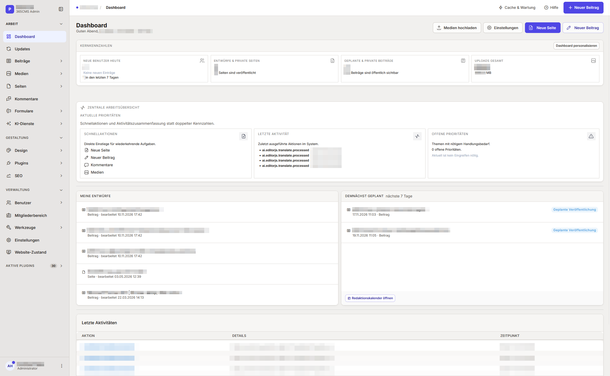
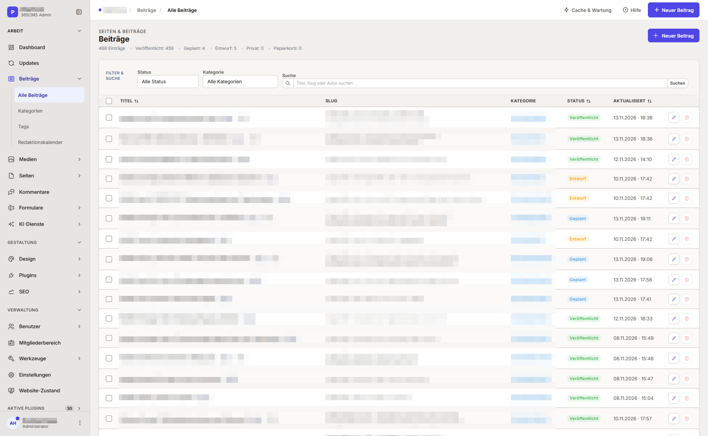
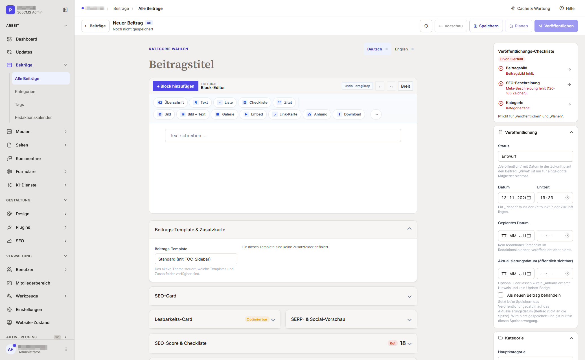
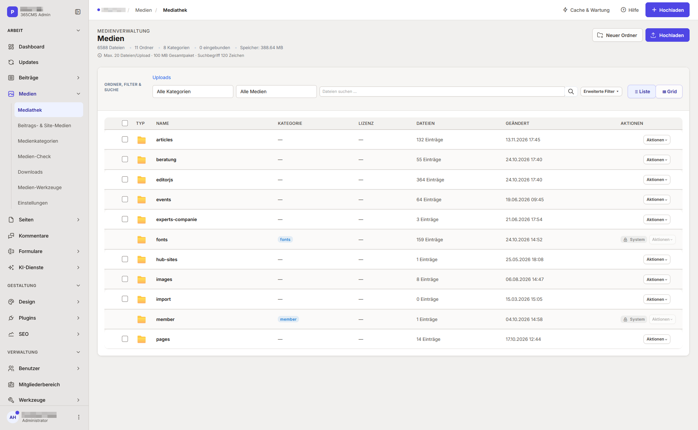
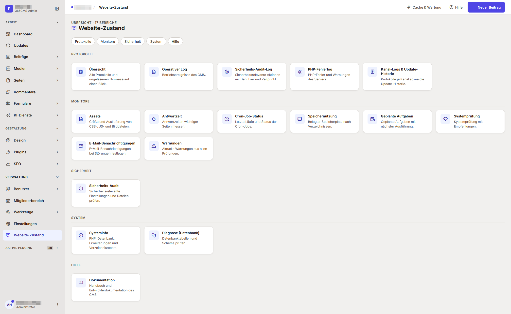

<div align="center">

<!-- Optional: Logo einbinden, falls gewünscht -->
<!--  -->

# 365CMS

**A modern, framework-less, security-first PHP 8.4+ CMS & Portal Platform.**  
*Zero bloat. Full enterprise security. All-in-one core (Forms, Newsletter, Knowledgebase, Downloads & Feeds).*

[](https://github.com/DEIN-USER/365CMS/releases)
[](https://www.php.net/)
[-4479A1?style=flat-square&logo=mysql&logoColor=white)](#requirements)
[](#core-capabilities)
[](https://365cms.de/)

[🌐 Official Website](https://365cms.de/) • [📖 Documentation](DOC/README.md) • [🚀 Quick Start](#quick-start) • [🇩🇪 Deutsche Version](#deutsch)

</div>

---

<p align="center">
  
</p>

| Posting List | Block Editor (New Post) | Media Library | Website Health |
|:---:|:---:|:---:|:---:|
|  |  |  |  |

---

## English

### ✨ Why 365CMS?

Most traditional CMS platforms either drown in legacy plugin dependencies and bloat or require complex Node.js/Docker build pipelines just to run a website. **365CMS** bridges the gap between lightweight performance and enterprise-grade capabilities:

- ⚡ **Framework-less & High Performance:** Built on clean, modern PHP `8.4.1+` with zero external framework overhead, anonymous lazy sessions (CDN/proxy cacheable), automated OPcache warmup, and native ES modules without a build step.
- 🔋 **Batteries Included (No Plugin Tax):** Essential portal features ship directly in the core—including a **Form Builder**, **Double-Opt-In Newsletter**, **Knowledgebase & Auto-Linking Glossary**, **Versioned Download Manager**, and **RSS Feed Aggregator**.
- 🛡️ **Security & Hardening by Default:** Strict Content Security Policy (CSP) with request nonces and **Trusted Types** runtime, authenticated encryption (`XChaCha20-Poly1305`), Passkeys (WebAuthn), TOTP MFA, LDAP/Active Directory, SSRF-protected HTTP client, and an integrated Security Audit suite.
- 🇪🇺 **Privacy, GDPR & Accessibility Native:** Consent-gated analytics (GA4, GTM, Matomo), local WOFF2 font hosting, automated data retention rules with dry-run previews, GDPR self-export/deletion workflows, and a WCAG 2.1 AA / EN 301 549 accessibility statement generator.
- 🧱 **Modern Editorial Experience:** Powered by a heavily customized **Editor.js** canvas with block-level revisions & diffs, enforced publish checklists, distraction-free focus mode, editorial calendar, native DE/EN content workflows, and optional admin-only AI assistance.

---

### 📊 Key Facts & Architecture

| Key Fact | Details |
| :--- | :--- |
| **Core Version** | `4.0.0` ([`CMS/core/Version.php`](CMS/core/Version.php), released `2026-11-12`, status `stable`) |
| **PHP Requirement** | `8.4.1+` enforced (`CMS\Version::MIN_PHP`, `CMS_MIN_PHP_VERSION`) |
| **Database** | MySQL `8.0+` / MariaDB `10.6+` via PDO (`utf8mb4`), table prefix `cms_`, schema `v25` |
| **Architecture** | Modular DI container (`CMS\Container`), specialized routers (`Web`, `Admin`, `Member`, `API`, `CLI`), event-driven hooks |
| **Frontend & Admin UI** | Tabler-based responsive admin shell, zero-build ES modules (`admin-shell/`, `post-editor/`, `editor-blocks/`), local WOFF2 fonts |
| **Shipped Theme & Plugin** | `cms-default` (*Meridian CMS Default*) & `cms-importer` (*WordPress XML Importer*) |
| **Quality Assurance** | 16 database-free automated test suites (`php TESTS/run-all.php`) + CI security scanning |

---

### 🚀 Core Capabilities

| Area | Current Runtime Capabilities |
| :--- | :--- |
| **Content & Editorial** | Pages, posts, **Editor.js** blocks (SunEditor legacy fallback), block-level revisions with visual diff & restore, enforced publish checklists (featured image, category, 120–160 char meta description), focus mode, editorial calendar with drag & drop, scheduled publishing, native **DE/EN** localization, hub sites, interactive site tables, and automatic TOC. |
| **Built-in Portal Modules** | **Forms** (15 field types, spam protection, private file uploads, CSV export), **Newsletter** (double opt-in, templates, segments, cron batch sending, RFC 8058 one-click unsubscribe), **Knowledgebase** (glossary with automatic content linking & tooltips, CSV packages), **Downloads** (versioning, IP rate limiting, private storage delivery), and **Feed Aggregator** (OPML import/export, hourly digests). |
| **Administration & MultiSites** | Customizable sidebar profiles (*Classic*, *Structured*, or drag-and-drop *Custom Layout* with JSON import/export), **MultiSites** admin context switcher (per-domain accent colors, plugin assignment, custom menus), tile-based configuration pages, and live administrator system notices (cron, backups, updates). |
| **Member Area (`/member`)** | Self-service dashboard, rich profile editor, security center (Passkeys/WebAuthn, TOTP MFA with backup codes, active session & API token revocation), private media storage, internal messaging, notifications, favorites, subscriptions, GDPR data export, and plugin sections. |
| **SEO & Legal Compliance** | Dynamic XML sitemaps (posts, pages, images, news, plugins, glossary), IndexNow API integration, 301 redirect manager & 404 monitor, Schema.org JSON-LD, consent-gated analytics (GA4, GTM, Matomo, Meta Pixel), cookie manager, legal text generator (Imprint, Privacy, Accessibility), and automated data retention rules. |
| **Security & Hardening** | Per-action CSRF tokens, granular RBAC capability matrix, CSP with nonces & **Trusted Types** DOM sanitizer, IP & account-level login throttling, TOTP MFA, WebAuthn/Passkeys, LDAP/Active Directory authentication, encrypted backups (`libsodium` / `XChaCha20-Poly1305`), private storage outside web root (`CMS_PRIVATE_PATH`), and comprehensive audit logging. |
| **Admin-Only AI (Optional)** | Block-by-block Editor.js translation and SEO metadata generation with strict provider allowlists, SSRF protection, and atomic daily/monthly token quotas. *Strictly admin-only—zero public AI routes or automatic publishing.* |
| **Operations & Extensions** | 6-step web installer, CLI & web cron runner (`cron.php`), SMTP & Microsoft Graph OAuth2 mail queue, ZIP content import/export (`365cms-content-exchange`), SHA-256-verified plugin/theme marketplace, and incremental schema migrations. |

---

### 📋 Requirements

- **PHP:** `8.4.1+` with extensions `pdo`, `pdo_mysql`, `mbstring`, `json`, `openssl`, `curl`, `gd`, `zip`, `fileinfo`
- **Database:** MySQL `8.0+` or MariaDB `10.6+` (`utf8mb4` via PDO)
- **Web Server:** Apache 2.4 (`mod_rewrite` + `.htaccess`) or Nginx (`try_files` + security location blocks) serving `CMS/`
- **Filesystem Permissions:** Writable directories for `config/`, `uploads/`, `cache/`, `logs/`, `backups/`, and `private/` (or custom paths via `CMS_BACKUP_PATH` / `CMS_PRIVATE_PATH`)

---

### ⚡ Quick Start

1. **Deploy Runtime:** Upload the contents of [`CMS/`](CMS/) to your web root (or configure your virtual host document root to point directly to `CMS/`).
2. **Run Web Installer:** Open `https://your-domain.tld/install.php` in your browser and complete the 6-step wizard (system check, database connection, site & core modules, admin sidebar profile, administrator account, completion).
3. **Automatic Lockdown:** The installer generates cryptographic keys (`AUTH_KEY`, `CMS_ENCRYPTION_KEY`), writes `CMS/config/app.php`, initializes schema `v25`, and locks itself automatically.
4. **Initial Setup:** Log in at `/cms-login`, open `/admin`, and configure mail delivery (SMTP / Microsoft Graph), backup storage (`CMS_BACKUP_PATH`), and run the **Security Audit** (`/admin/security-audit`).
5. **Schedule Cron:** Set up a recurring cron job (recommended: every 5–15 minutes or hourly) for mail queues, digests, search indexing, and data retention:
   ```bash
   php /path/to/CMS/cron.php --task=all
   ```

> **Production Security Note:** Never ship installation-specific directories (`config/`, `uploads/`, `cache/`, `logs/`, `backups/`, `private/`) in release archives. See [`DOC/INSTALLATION.md`](DOC/INSTALLATION.md) for Nginx configuration snippets, permission hardening, and production checklists.

---

### 🏗️ Repository & Runtime Architecture

```text
365CMS/
├── CMS/                  # Productive application runtime (point web root here)
│   ├── admin/            # Backend entry points, domain modules, views & settings tabs
│   ├── assets/           # CSS, zero-build ES modules, local WOFF2 fonts & vendor libraries
│   ├── config/           # Configuration template (app.php) & media settings
│   ├── core/             # Bootstrap, DI container, routers, services, auth & schema (v25)
│   ├── includes/         # Global helpers & WordPress compatibility layer
│   ├── install/          # 6-step web installer & CLI/Web database updater
│   ├── lang/             # UI localization catalogs (de.yaml, en.yaml)
│   ├── member/           # Frontend member portal (/member)
│   ├── plugins/          # Installed plugins (ships with cms-importer)
│   └── themes/           # Installed themes (ships with cms-default / Meridian)
├── DOC/                  # Comprehensive bilingual documentation & audit reports
├── RELEASE/              # Official release ZIPs (-full, -update) & SHA-256 checksums
├── SCREENSHOTS/          # UI & dashboard screenshots
└── TESTS/                # 16 database-free test suites (php TESTS/run-all.php)
```

---

### 📚 Documentation

| Topic | Link |
| :--- | :--- |
| **Documentation Hub & Index** | [`DOC/README.md`](DOC/README.md) · [`DOC/INDEX.md`](DOC/INDEX.md) |
| **Installation & Server Hardening** | [`DOC/INSTALLATION.md`](DOC/INSTALLATION.md) |
| **Architecture & Core Services** | [`DOC/core/ARCHITECTURE.md`](DOC/core/ARCHITECTURE.md) · [`DOC/core/SERVICES.md`](DOC/core/SERVICES.md) · [`DOC/DEVLIST.md`](DOC/DEVLIST.md) |
| **Database Schema & Hooks** | [`DOC/core/DATABASE-SCHEMA.md`](DOC/core/DATABASE-SCHEMA.md) · [`DOC/core/HOOKS-REFERENCE.md`](DOC/core/HOOKS-REFERENCE.md) |
| **Admin Guide & Menu Profiles** | [`DOC/admin/GUIDE.md`](DOC/admin/GUIDE.md) · [`DOC/admin/ADMIN-MENU.md`](DOC/admin/ADMIN-MENU.md) |
| **Plugin & Theme Development** | [`DOC/plugins/PLUGIN-DEVELOPMENT.md`](DOC/plugins/PLUGIN-DEVELOPMENT.md) · [`DOC/theme/THEME-DEVELOPMENT.md`](DOC/theme/THEME-DEVELOPMENT.md) |
| **Operational Workflows** | [`DOC/workflow/`](DOC/workflow/) |
| **Security & Audit Reports** | [`DOC/core/SECURITY.md`](DOC/core/SECURITY.md) · [`DOC/audit/README.md`](DOC/audit/README.md) · [`DOC/checks/README.md`](DOC/checks/README.md) |
| **Releases & Changelog** | [`RELEASE/README-4.0.0.md`](RELEASE/README-4.0.0.md) · [`Changelog.md`](Changelog.md) |
| **Community Guidelines** | [`CODE_OF_CONDUCT.md`](CODE_OF_CONDUCT.md) |

---

### 🤝 Contributing & Security Policy

- **Contributing:** Keep pull requests focused, document behavioral changes in [`DOC/`](DOC/) and [`Changelog.md`](Changelog.md), and run both `php -l` and the test suite (`php TESTS/run-all.php`) before opening a PR. Please adhere to our [`CODE_OF_CONDUCT.md`](CODE_OF_CONDUCT.md).
- **Security Disclosures:** Please report security vulnerabilities **privately** to the maintainers instead of publishing exploit details in public issues.

---
---

<a name="deutsch"></a>

## 🇩🇪 Deutsch

### ✨ Warum 365CMS?

Klassische CMS-Systeme leiden häufig unter aufgeblähten Plugin-Abhängigkeiten, veralteten Sicherheitskonzepten oder komplexen Build-Pipelines (Node.js, Docker, Composer-Zwang auf dem Zielserver). **365CMS** verbindet maximale Performance mit echter Enterprise-Sicherheit und einem vollwertigen Funktionsumfang direkt im Core:

- ⚡ **Frameworkfrei & extrem schnell:** Saubere, moderne PHP-`8.4.1+`-Architektur ohne externen Framework-Overhead, mit Lazy-Sessions für anonyme Besucher (optimal für CDN/Reverse-Proxy-Caching), automatischem OPcache-Warmup und nativen ES-Modulen ohne Build-Schritt.
- 🔋 **Alles im Core enthalten (keine Plugin-Steuer):** Wichtige Portal-Funktionen sind bereits fest integriert – darunter **Formular-Baukasten**, **Double-Opt-In-Newsletter**, **Knowledgebase & Glossar**, **Download-Manager** sowie ein **RSS-Feed-Aggregator**.
- 🛡️ **Sicherheit ab Werk (Security-First):** Strikte Content Security Policy (CSP) mit Request-Nonces und **Trusted Types**, authentifizierte Verschlüsselung (`XChaCha20-Poly1305`), Passkeys (WebAuthn), TOTP-MFA, LDAP/Active Directory, SSRF-geschützter HTTP-Client und ein integriertes Sicherheits-Audit.
- 🇪🇺 **DSGVO- & Barrierefreiheits-nativ:** Einwilligungsgesteuerte Analytics (GA4, GTM, Matomo), lokales WOFF2-Font-Hosting, automatisierte Löschfristen mit Probelauf, DSGVO-Selbstauskunft/-Löschung und Generator für Barrierefreiheitserklärungen (WCAG 2.1 AA / EN 301 549).
- 🧱 **Moderne Redaktion:** Angepasster **Editor.js**-Blockeditor mit Block-Revisionen & Diff-Ansicht, erzwungener Veröffentlichungs-Checkliste, ablenkungsfreiem Fokusmodus, Redaktionskalender, nativer DE/EN-Mehrsprachigkeit sowie optionaler Admin-KI.

---

### 📊 Eckdaten & Architektur

| Eckdaten | Details |
| :--- | :--- |
| **Core-Version** | `4.0.0` ([`CMS/core/Version.php`](CMS/core/Version.php), veröffentlicht `2026-11-12`, Status `stable`) |
| **PHP-Voraussetzung** | `8.4.1+` erzwungen (`CMS\Version::MIN_PHP`, `CMS_MIN_PHP_VERSION`) |
| **Datenbank** | MySQL `8.0+` / MariaDB `10.6+` über PDO (`utf8mb4`), Tabellenpräfix `cms_`, Schema `v25` |
| **Architektur** | Modularer DI-Container (`CMS\Container`), spezialisierte Router (`Web`, `Admin`, `Member`, `API`, `CLI`), Event-Hooks |
| **Admin- & Frontend-UI** | Responsive Tabler-Admin-Shell, ES-Module ohne Build-Schritt (`admin-shell/`, `post-editor/`, `editor-blocks/`), lokale WOFF2-Schriften |
| **Standard-Theme & Plugin** | `cms-default` (*Meridian CMS Default*) & `cms-importer` (*WordPress XML-Importer*) |
| **Qualitätssicherung** | 16 datenbankfreie Test-Suiten (`php TESTS/run-all.php`) + automatisierte CI-Sicherheitsprüfungen |

---

### 🚀 Zentrale Funktionen im Überblick

| Bereich | Aktuelle Runtime-Funktionen |
| :--- | :--- |
| **Inhalte & Redaktion** | Seiten, Beiträge, **Editor.js**-Blöcke (SunEditor als Legacy-Option), Beitragsrevisionen mit Block-Vergleich und Wiederherstellung, Veröffentlichungs-Checkliste (Beitragsbild, Kategorie, Meta-Beschreibung 120–160 Zeichen), Fokusmodus, Redaktionskalender mit Drag & Drop, geplante Veröffentlichung, native **DE/EN**-Inhalte, Hub-Sites, interaktive Site-Tabellen und Inhaltsverzeichnis. |
| **Integrierte Portal-Module** | **Formulare** (15 Feldtypen, Spamschutz, privater Datei-Upload, CSV-Export), **Newsletter** (Double-Opt-In, Vorlagen, Segmente, Cron-Stapelversand, RFC-8058-Abmeldung), **Knowledgebase** (Glossar mit automatischer Verlinkung & Tooltips, CSV-Pakete), **Downloads** (Versionierung, IP-Rate-Limit, Auslieferung aus privatem Speicher) und **Feed-Aggregator** (OPML-Import/-Export, stündliche Digests). |
| **Administration & MultiSites** | Anpassbare Sidebar-Profile (*Klassisch*, *Strukturiert* oder eigenes Drag-&-Drop-Layout mit JSON-Import/-Export), **MultiSites**-Kontextumschalter (Akzentfarben, Plugin-Zuweisung und Menüs je Site), Kachel-Einstellungsseiten und Live-Systemhinweise (Cron, Backups, Updates). |
| **Mitgliederbereich (`/member`)** | Self-Service-Dashboard, Profil-Editor, Sicherheitscenter (Passkeys/WebAuthn, TOTP-MFA mit Backup-Codes, Widerruf aktiver Sitzungen & API-Tokens), privater Medienspeicher, interne Nachrichten, Benachrichtigungen, Favoriten, Abos, DSGVO-Datenexport und Plugin-Bereiche. |
| **SEO & Recht** | Dynamische XML-Sitemaps (Beiträge, Seiten, Bilder, News, Plugins, Glossar), IndexNow-Integration, 301-Weiterleitungen & 404-Monitor, Schema.org JSON-LD, einwilligungsgesteuerte Analytics (GA4, GTM, Matomo, Meta Pixel), Cookie-Manager, Rechtstexte-Generator (Impressum, Datenschutz, Barrierefreiheit) und automatisierte Löschfristen. |
| **Sicherheit & Härtung** | CSRF-Token je Aktion, granulare RBAC-Rechtematrix, CSP mit Nonces & **Trusted Types** DOM-Sanitizer, IP- & Konto-basiertes Login-Rate-Limit, TOTP-MFA, WebAuthn/Passkeys, LDAP/Active Directory, verschlüsselte Backups (`libsodium` / `XChaCha20-Poly1305`), privater Speicher außerhalb des Webroots (`CMS_PRIVATE_PATH`) und lückenloses Audit-Log. |
| **KI (optional, nur Admin)** | Blockweise Editor.js-Übersetzung und SEO-Metadaten-Assistent mit strikten Provider-Allowlists, SSRF-Schutz und atomaren Tages-/Monats-Quotas. *Ausschließlich im Admin – keine öffentlichen AI-Routen oder automatische Veröffentlichung.* |
| **Betrieb & Erweiterungen** | 6-stufiger Web-Installer, CLI- & Web-Cron (`cron.php`), SMTP- & Microsoft-Graph-OAuth2-Mail-Queue, ZIP-Content-Import/-Export (`365cms-content-exchange`), SHA-256-geprüfter Plugin-/Theme-Marketplace und inkrementelle Schema-Migrationen. |

---

### 📋 Systemvoraussetzungen

- **PHP:** `8.4.1+` mit den Erweiterungen `pdo`, `pdo_mysql`, `mbstring`, `json`, `openssl`, `curl`, `gd`, `zip`, `fileinfo`
- **Datenbank:** MySQL `8.0+` oder MariaDB `10.6+` über PDO (`utf8mb4`)
- **Webserver:** Apache 2.4 (`mod_rewrite` + `.htaccess`) oder Nginx (`try_files` + Sicherheits-Location-Blöcke), der `CMS/` ausliefert
- **Dateirechte:** Beschreibbare Verzeichnisse für `config/`, `uploads/`, `cache/`, `logs/`, `backups/` und `private/` (oder eigene Pfade über `CMS_BACKUP_PATH` / `CMS_PRIVATE_PATH`)

---

### ⚡ Schnellstart

1. **Runtime bereitstellen:** Den Inhalt von [`CMS/`](CMS/) in den Webroot kopieren (oder das Document-Root des Virtual Hosts direkt auf `CMS/` zeigen lassen).
2. **Web-Installer starten:** `https://ihre-domain.tld/install.php` im Browser öffnen und den 6-stufigen Assistenten durchlaufen (Systemprüfung, Datenbank, Website & Core-Module, Admin-Layout, Administrator-Konto, Abschluss).
3. **Automatische Absicherung:** Der Installer erzeugt kryptografische Schlüssel (`AUTH_KEY`, `CMS_ENCRYPTION_KEY`), schreibt `CMS/config/app.php`, richtet Schema `v25` ein und sperrt sich anschließend selbst.
4. **Ersteinrichtung:** Unter `/cms-login` anmelden, `/admin` öffnen, Mailversand (SMTP / Microsoft Graph) und Backup-Pfad (`CMS_BACKUP_PATH`) konfigurieren sowie das **Sicherheits-Audit** (`/admin/security-audit`) ausführen.
5. **Cronjob einrichten:** Einen regelmäßigen Cronjob (empfohlen: alle 5–15 Minuten oder stündlich) für Mail-Queue, Digests, Suchindex und Löschfristen anlegen:
   ```bash
   php /pfad/zu/CMS/cron.php --task=all
   ```

> **Sicherheitshinweis für Produktion:** Installationsspezifische Verzeichnisse (`config/`, `uploads/`, `cache/`, `logs/`, `backups/`, `private/`) gehören niemals in ein Release-Archiv. Details zu Nginx-Regeln, Dateirechten und Produktions-Checklisten finden sich in [`DOC/INSTALLATION.md`](DOC/INSTALLATION.md).

---

### 🏗️ Repository- & Runtime-Struktur

```text
365CMS/
├── CMS/                  # Produktive Laufzeitumgebung (Webroot hierher zeigen lassen)
│   ├── admin/            # Backend-Einstiege, Fachmodule, Views & Einstellungs-Tabs
│   ├── assets/           # CSS, ES-Module ohne Build-Schritt, lokale WOFF2-Fonts & Libraries
│   ├── config/           # Konfigurationsvorlage (app.php) & Medien-Einstellungen
│   ├── core/             # Bootstrap, DI-Container, Router, Services, Auth & Schema (v25)
│   ├── includes/         # Globale Helfer & WordPress-Kompatibilitätsschicht
│   ├── install/          # 6-stufiger Web-Installer & CLI-/Web-Datenbank-Updater
│   ├── lang/             # Sprachkataloge für die Oberfläche (de.yaml, en.yaml)
│   ├── member/           # Mitgliederbereich (/member)
│   ├── plugins/          # Installierte Plugins (inkl. cms-importer)
│   └── themes/           # Installierte Themes (inkl. cms-default / Meridian)
├── DOC/                  # Umfassende zweisprachige Dokumentation & Audit-Berichte
├── RELEASE/              # Offizielle Release-Pakete (-full, -update) & SHA-256-Prüfsummen
├── SCREENSHOTS/          # UI- & Dashboard-Screenshots
└── TESTS/                # 16 datenbankfreie Test-Suiten (php TESTS/run-all.php)
```

---

### 📚 Dokumentation

| Thema | Link |
| :--- | :--- |
| **Dokumentations-Einstieg & Index** | [`DOC/README.md`](DOC/README.md) · [`DOC/INDEX.md`](DOC/INDEX.md) |
| **Installation & Server-Härtung** | [`DOC/INSTALLATION.md`](DOC/INSTALLATION.md) |
| **Architektur & Core-Services** | [`DOC/core/ARCHITECTURE.md`](DOC/core/ARCHITECTURE.md) · [`DOC/core/SERVICES.md`](DOC/core/SERVICES.md) · [`DOC/DEVLIST.md`](DOC/DEVLIST.md) |
| **Datenbankschema & Hooks** | [`DOC/core/DATABASE-SCHEMA.md`](DOC/core/DATABASE-SCHEMA.md) · [`DOC/core/HOOKS-REFERENCE.md`](DOC/core/HOOKS-REFERENCE.md) |
| **Admin-Leitfaden & Menü-Profile** | [`DOC/admin/GUIDE.md`](DOC/admin/GUIDE.md) · [`DOC/admin/ADMIN-MENU.md`](DOC/admin/ADMIN-MENU.md) |
| **Plugin- & Theme-Entwicklung** | [`DOC/plugins/PLUGIN-DEVELOPMENT.md`](DOC/plugins/PLUGIN-DEVELOPMENT.md) · [`DOC/theme/THEME-DEVELOPMENT.md`](DOC/theme/THEME-DEVELOPMENT.md) |
| **Operative Workflows** | [`DOC/workflow/`](DOC/workflow/) |
| **Sicherheit & Audit-Berichte** | [`DOC/core/SECURITY.md`](DOC/core/SECURITY.md) · [`DOC/audit/README.md`](DOC/audit/README.md) · [`DOC/checks/README.md`](DOC/checks/README.md) |
| **Release-Pakete & Changelog** | [`RELEASE/README-4.0.0.md`](RELEASE/README-4.0.0.md) · [`Changelog.md`](Changelog.md) |
| **Verhaltenskodex** | [`CODE_OF_CONDUCT.md`](CODE_OF_CONDUCT.md) |

---

### 🤝 Mitwirken & Sicherheit

- **Mitwirken:** Bitte Änderungen fokussiert halten, Verhaltensänderungen in [`DOC/`](DOC/) und [`Changelog.md`](Changelog.md) dokumentieren sowie vor einem Pull Request sowohl die PHP-Syntax (`php -l`) als auch die Test-Suite (`php TESTS/run-all.php`) ausführen. Es gilt der [`CODE_OF_CONDUCT.md`](CODE_OF_CONDUCT.md).
- **Sicherheitslücken melden:** Bitte melden Sie Sicherheitsprobleme **privat** an die Maintainer, statt Exploit-Details in einem öffentlichen Issue zu veröffentlichen.

---

<div align="center">

**If you find 365CMS useful, please consider giving it a ⭐ on GitHub!**  
*Gefällt Ihnen 365CMS? Wir freuen uns über einen ⭐ auf GitHub!*

</div>
